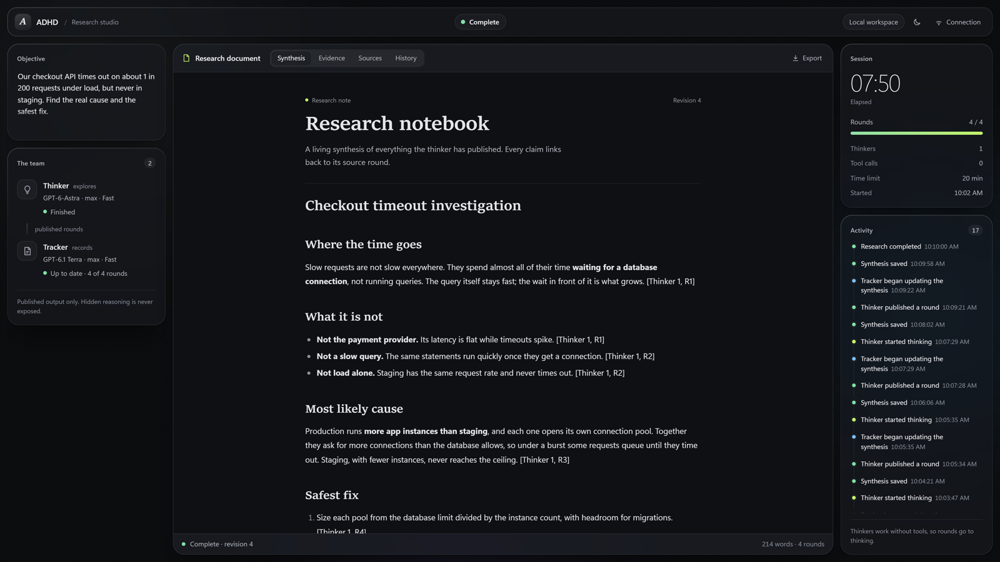

# ADHD

**Allowed to Drift. Held to Direction.**

ADHD is a deep-research loop for AI models. A thinker model does nothing but think: it has no tools and never waits on anything. A separate tracker model keeps the research notebook organized in the background. Every round the thinker publishes enters the document word for word, straight away. The tracker can organize, connect and annotate, but it can't remove or hold back anything.

Models left alone tend to grab one idea, chase it down a rabbit hole, and lose the big picture. ADHD lets the thinker wander as far as it likes, and keeps the objective in front of it every round. Evidence you supply (test results, measurements, corrections) reaches the next round without pausing it.



<sub>The live notebook (a demo session).</sub>

## Quick start

You need **Node.js 24 or newer** and at least one signed-in backend: Claude Code, the Codex CLI, the Devin CLI (its `swe-2` models were free at the time of writing), or any OpenAI-compatible endpoint such as a local Ollama.

```bash
git clone https://github.com/OnlyTerp/adhd.git

# Claude Code
claude mcp add -s user adhd -- node "$PWD/adhd/native/mcp.mjs"
mkdir -p ~/.claude/skills && cp -r adhd/skill/adhd ~/.claude/skills/

# Codex
codex mcp add adhd -- node "$PWD/adhd/native/mcp.mjs"
mkdir -p ~/.codex/skills && cp -r adhd/skill/adhd ~/.codex/skills/
```

These are bash commands; on Windows run them in Git Bash.

Restart your agent app and ask it to "run ADHD on" a hard question. It reads the catalog of models you have, starts the loop, opens the live notebook and feeds results back as evidence. The repository ships with its viewer assets built, so no `npm install` is needed to use it. Other apps: see [Use from an agent](#use-from-an-agent-mcp--skill).

## What it does

- **Uninterrupted thinking.** The next round starts as soon as the last one is saved, usually a few milliseconds later. Recording, exports, evidence and the tracker never gate it.
- **A lossless notebook.** Sources are stored verbatim in SQLite and shown in the main document before the tracker gets to them. Tracker notes are additive.
- **Big-picture guard.** Every round restates the objective and asks the thinker to say so when it has drifted. The tracker's first next direction names any drift it sees.
- **Evidence feedback.** You submit attributed observations with provenance. Each round records exactly which evidence and tracker feedback it received.
- **No early quitting.** A thinker that says the goal is answered gets one review round to check its own answer, and stops only if it claims completion again (a claim on the last allowed round ends it without the review; `blocked` on the last round ends the run as `blocked` at once). Evidence it has not seen reopens it, and a thinker that says it is blocked waits for evidence until the time limit, then the run ends as `blocked`. `maxRounds` is a cap, not a target. A continuous run pauses once every thinker has confirmed the answer, and new evidence resumes it. The review costs one extra thinker round per finished run.
- **Pause, stop, recover, export.** Exports are hash-verified packages you can restore read-only on another machine.
- **A local viewer.** A clean, live web view of the notebook that renders Markdown and KaTeX safely.

## Any model, any harness

ADHD is an MCP server plus a skill, so any agent app that speaks MCP can drive it: Claude Code, Codex, Claude Desktop, OMP, opencode, Cursor and others. It looks best in apps that can open a browser pane beside the chat, because the live notebook is a local web page.

The thinkers and the tracker run on **backends**. Pick any model the catalog offers for either role. A model you have spare usage on, or one that is good at the subject, can do the thinking.

| Backend | Models | Login | Tool-free | Usage guard | Cost |
| --- | --- | --- | --- | --- | --- |
| `codex` | Every model your Codex catalog offers, for example `gpt-6-astra`, `gpt-6.1-terra` | Your ChatGPT login | attested by the app-server | reads plan usage; stops before purchased credits | plan |
| `claude` | `claude-opus-5-5`, `claude-sonnet-5-5` | Your Claude subscription in Claude Code | attested per turn | stops on Claude extra usage or a reached limit | plan |
| `devin` | `swe-2`, `swe-2-flash` | Your Devin CLI login | tool-less agent; any tool use fails the turn | token counts | free at the time of writing |
| `openai:<name>` | Whatever your endpoint serves | API key from an environment variable | plain completions, no tools sent | `maxTokens` required for per-token billing | yours |

`openai:<name>` covers any OpenAI-compatible endpoint: Ollama, LM Studio, vLLM, llama.cpp, OpenRouter and provider gateways. List them in `~/.adhd/data/endpoints.json` (or point `GOAL_LOOP_ENDPOINTS` at a file):

```json
[{"name": "local", "baseUrl": "http://127.0.0.1:11434/v1", "billing": "local",
  "models": [{"id": "qwen3:14b", "contextTokens": 32768}]},
 {"name": "router", "baseUrl": "https://openrouter.ai/api/v1", "apiKeyEnv": "OPENROUTER_API_KEY", "billing": "per-token",
  "models": [{"id": "some/model", "contextTokens": 131072}]}]
```

An endpoint on another machine in your own network (for example an Ollama box) may use plain `http` when it needs no key; anything with a key must use `https`. `billing: "local"` is accepted only for this machine or a private-network address. A broken `endpoints.json` disables only the endpoints and is reported under `unavailable` in the catalog.

Keys stay in the environment. They are never written to the database, the audit log or exports. Since these endpoints keep no conversation state, ADHD keeps the history itself, in a byte-stable order so provider prompt caching works, and compacts it when it nears the model's context size.

A selection is `{"backend", "modelId", "speedId", "reasoning"}` with values from `goal_loop_catalog`. ADHD never substitutes a different model. By default Claude and Codex refuse API keys and third-party routes, so runs use your subscription (`GOAL_LOOP_CLAUDE_ALLOW_API_KEY=1` allows a key for Claude).

**Defaults.** Thinkers think at max effort where the backend can set it. With no thinkers named, ADHD uses the strongest installed model whose plan is not used up (Astra, then Opus, then the first model listed); the catalog shows the Codex plan's usage. The tracker only organizes, so it defaults to something cheap: Terra with a Codex thinker, Sonnet at medium effort with a Claude thinker, otherwise the thinker's own model.

## Develop

```bash
git clone https://github.com/OnlyTerp/adhd.git
cd adhd
npm ci
npm run build
npm test
```

## Run from the command line

Write a spec file:

```json
{
  "goal": "Why does checkout time out under load, and what is the smallest fix?",
  "context": "Relevant excerpts, measurements, constraints and unknowns.",
  "configuration": {
    "thinkers": [{"backend": "claude", "modelId": "claude-opus-5-5", "speedId": "standard", "reasoning": "max"}],
    "tracker": {"backend": "devin", "modelId": "swe-2-flash", "speedId": "standard", "reasoning": "default"},
    "continuous": true
  }
}
```

```bash
node native/cli.mjs catalog
node native/cli.mjs run --spec research.json
```

### Usage protection

A research loop runs for hours, so a mistake can cost real money. ADHD guards every backend it can measure:

- **`allowCredits`** (default `false`): a run won't start, and it stops, once a Codex plan limit is used up or Claude starts drawing on paid extra usage. Without this guard, Codex at 100% keeps going on purchased credits, and one max-reasoning Astra round can cost tens of dollars.
- **`maxUsagePercent`** (default `90`): a continuous Codex run pauses when your plan usage reaches this percentage.
- **`maxTokens`**: caps the whole run's input plus output tokens on any backend. It is required for a per-token endpoint.
- **Token use:** every turn's input, cached input and output tokens are recorded. Status shows `cacheHitPercent`; a long run with a low figure is re-reading its history at full price.
- **Effort and tier:** max effort and the `priority`/`ultrafast` tiers are faster or deeper and cost more per round.

`run` prints the viewer URL. Type `quit` to stop. Continuous runs go on until you pause or stop them. For a bounded run, use `"maxRounds"` and `"maxMinutes"` instead of `"continuous"`. Data lives in `~/.adhd/data` unless you pass `--data` or set `GOAL_LOOP_DATA`.

## Use from an agent (MCP + skill)

Register the server in your agent app, then copy `skill/adhd/` into its skills folder (for example `~/.claude/skills/adhd` or `~/.codex/skills/adhd`). The skill teaches the agent the workflow: read the catalog, choose models, start, open the live page, feed evidence, stop.

```bash
claude mcp add adhd -- node /path/to/adhd/native/mcp.mjs
codex mcp add adhd -- node /path/to/adhd/native/mcp.mjs
```

Other apps take the same command in their MCP settings (`command: node`, `args: ["/path/to/adhd/native/mcp.mjs"]`).

| Tool | Purpose |
| --- | --- |
| `goal_loop_catalog` | Models the installed hosts actually offer |
| `goal_loop_start` | Start a run with a goal, context and configuration (keep its `requestId` for retries) |
| `goal_loop_status` | Lifecycle, recorder coverage and timing metrics |
| `goal_loop_evidence` | Add an attributed observation or correction; it reaches the next round (the receipt's `notice` says when the run is paused, resumed for it, or has no thinker left to read it) |
| `goal_loop_read` | The document, sources, tracker notes or input packets |
| `goal_loop_control` | `pause`, `resume`, `stop`, `recover_recording`, `repair_export` |
| `goal_loop_export` | A hash-manifested research package |

The owning agent runs tests and retrieval itself, then submits the results as evidence. The thinker and tracker never get tools.

## Honest limits

- Workers get no tools. Codex and Claude attest that; the Devin profile launches its tool-less agent and fails any turn that tries a tool. That is not proof that every host feature is excluded.
- Only the `codex`, `claude` and `devin` backends have run live, and live runs so far were on Windows. The test suite runs on Linux, macOS and Windows in CI. The OpenAI-compatible backend is tested against a local fake server only.
- The harness that drives ADHD cannot lend it its own model: ADHD runs models it can start itself.
- Timing metrics measure this controller, not provider inference speed or cost.
- ADHD does not check prices. The `devin` backend is labelled free because the `swe-2` models were free when it was written; check Devin's current pricing.
- Claude effort is requested, not reported back by the CLI. Devin and many endpoints cannot set effort at all. Claude reports the model at the first turn, so a mismatch fails that turn after inference has started.
- The big-picture guard is a prompt instruction to the thinker and tracker. The tests check that every round carries it, not how well a model follows it.
- A slow tracker never holds up the thinker, but its notes arrive less often and refer to older rounds.
- Claude's guard reacts to the plan events the CLI reports during a turn, so at most the turn that crossed into extra usage is paid. Devin and endpoints report tokens only; use `maxTokens`.
- Stopping confirms the local host processes exited, not upstream billing cancellation.
- The `worker/`, `db/` and `drizzle/` folders are an optional hosted storage service. They aren't needed for local use and aren't deployed by this repository. `npm run package:worker` bundles it and needs your own `.openai/hosting.json`.

## Tests

`npm test` runs the full suite with fake hosts, using no model usage. `scripts/verify-native-continuous.mjs <dir>` is an opt-in live acceptance run on your own subscriptions. Choose its workers with JSON in `GOAL_LOOP_VERIFY_THINKER` and `GOAL_LOOP_VERIFY_TRACKER`, and its length with `GOAL_LOOP_VERIFY_ROUNDS` (default 6) and `GOAL_LOOP_VERIFY_MINUTES`:

```bash
GOAL_LOOP_VERIFY_THINKER='{"backend":"claude","modelId":"claude-opus-5-5","speedId":"standard","reasoning":"max"}' \
GOAL_LOOP_VERIFY_TRACKER='{"backend":"claude","modelId":"claude-sonnet-5-5","speedId":"standard","reasoning":"medium"}' \
GOAL_LOOP_VERIFY_ROUNDS=8 GOAL_LOOP_VERIFY_MINUTES=40 \
node scripts/verify-native-continuous.mjs ./verify-out
```

Measured on 2026-11-16 with that configuration: 8 Opus rounds in 8 minutes 14 seconds, one Sonnet note per round (16 to 38 seconds each), 73% of input tokens served from cache, and a gap of at most 5 ms between rounds. The run checks that a tracker note reaches a later round, so give it at least 6 rounds. With Devin `swe-2` as thinker and tracker, 6 rounds took 46 seconds.
